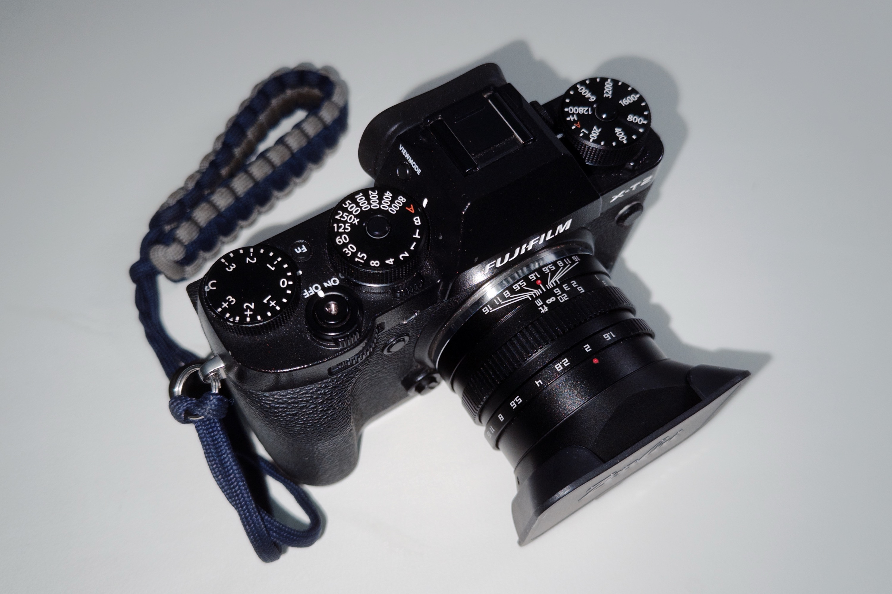

买了一台十年前发售的相机，富士X-T2，不想买新机是因为现在相机掉价太快了，而这种老相机都是两千以内的价格，亏也不会亏到哪里去。当然，选择这种老相机也是因为自己本身不需要多先进的功能，只是用来拍照那非常值得入手。这台富士X-T2算是旗舰机型，2430万像素、复古金属机身、防尘防水滴、双卡槽、日本产做工好，滤镜有cc和astia但没有nc，视频最高4k30帧1080p60帧机身无防抖，所以用来拍照还是可以的，视频就算了。

用了一段时间后感觉呢，机身还是比较大稍重了些，可能XE机型均衡些，不过我更喜欢X-T2这个造型，而且这个三向翻折屏也是我喜欢的点。

另外，我觉得应该买老的旗舰机型而不是新的入门机型，入门机型总会在一些。比如现在富士新的入门机型富士xm5，最快机械快门速度是1/4000s，但是富士X-T2这种十年前的机型就已经有最快1/8000s的机械快门。不管每家相机厂商都是这样等级森严，入门机型总是在基本拍摄功能上有所阉割，即便它是新发售的机型。

当然，也要分清入门机型和便携机型两个概念，想要便携必定要有所牺牲，我用过索尼ZV-E10和E20mmF2.8这个组合非常之便携，但同样也牺牲了很多方便的操作和摄影乐趣。

说到摄影的乐趣，每个人喜欢的东西不同，买相机的目的也各有差异。我买相机本来是没用过好奇当普通电子产品玩的，没想到有了相机之后为了拍一些东西更愿意出门了，不会整天都窝在屋里。

有一段时间我也学一些街头摄影师上街拍一些街头摄影，但是呢我的胆子不行跟陌生人的沟通能力解决冲突绯能有也不行，总所周知街头摄影师上街拍人，有些人并不喜欢给你拍，需要沟通说服别人给你拍，需要表达你的意图或者善意，而且在肖像权问题上也一直有争议，摄影师能不能随意发表拍到的人的照片，有时候会碰到有人明确要你删除拍到他的照片，一般只能照做，挺尴尬的，我还看到过帖子有人用胶片街拍，结果有人不乐意较真上了，最后只能把胶片洗出来把拍到的人的那张底片剪掉，有够麻烦。

不仅街头摄影，观鸟也玩过一段时间，然后就发现观鸟要出片需要好的设备，好的机身和长焦设备真的贵，而且你如果想要拍更多种类的鸟需要很多的时间去很多地点，一个地方的鸟类种类是有限的，想拍更过的鸟只能去国内其他省份甚至出国，才能出更多的片。简单的说，像拍鸟拍野生动物这种爱好就是靠堆钱出片的。

最近看到一位有名的日本摄影师，叫川内伦子。拍的是日常的琐碎记录。每个摄影师都有人喜欢和有人讨厌，喜欢的人喜欢这种平常生活的记录和感悟，不喜欢的人看到是你就拍这些司空见宽的东西，手法还这么粗糙，照片经常是过曝的风格。其实每个摄影师都有自己的风格，有的照片就是故意拍成过曝的风格，跟他表达的思想有关，有人能共鸣有人则无感自然就喜欢不起来。不管怎么说，普通人拍照能找到适合自己的领域和风格，觉得好玩就好了，单纯是个爱好。
